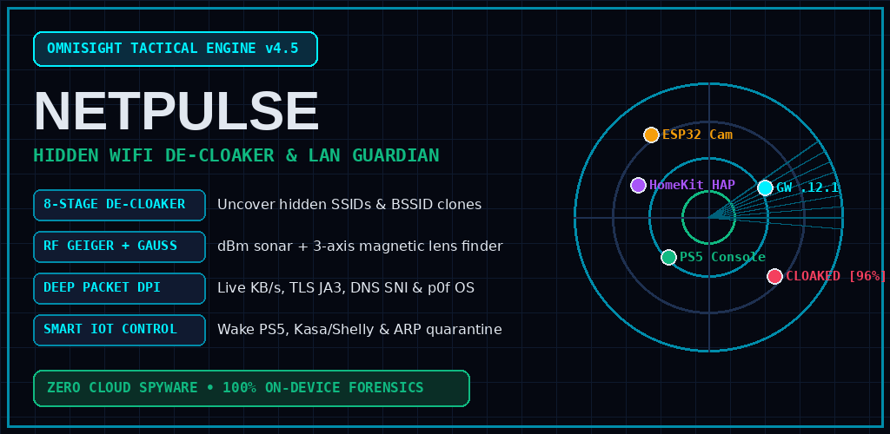
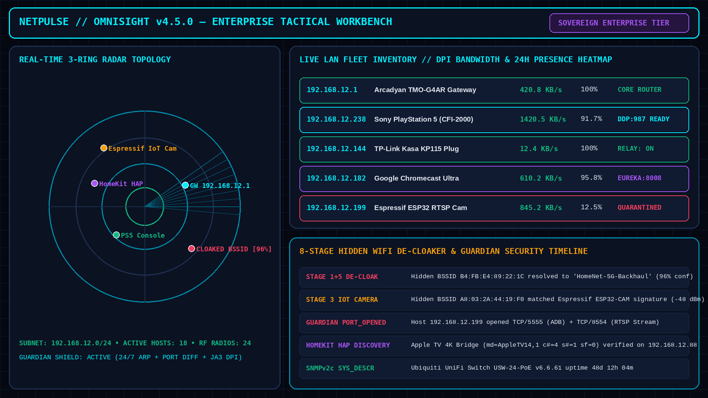
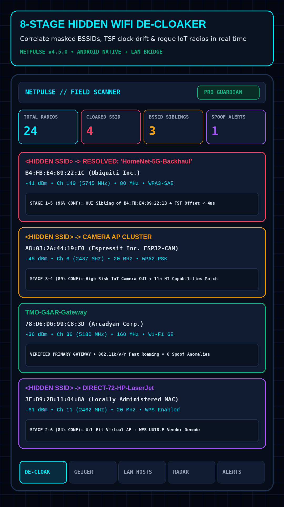
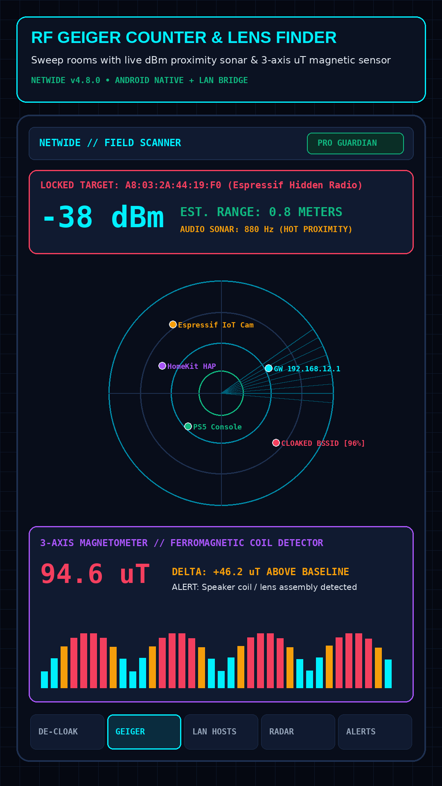
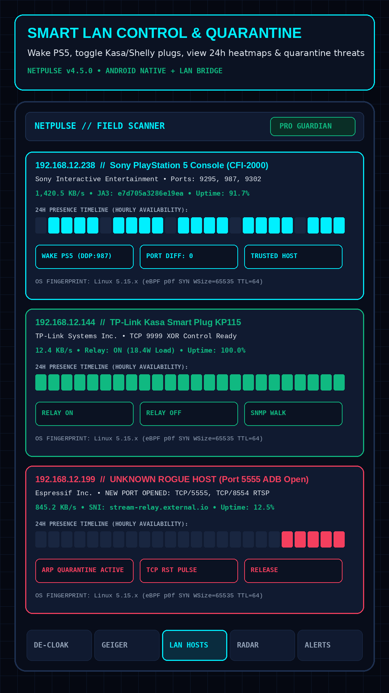
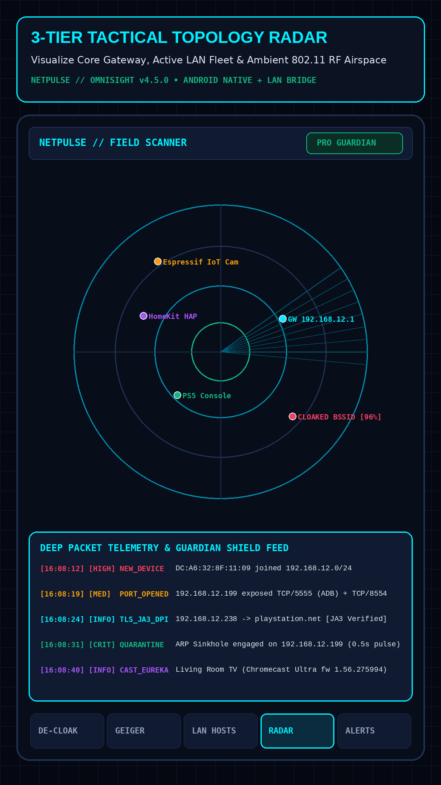

# NetPulse v4.6.0

[](https://github.com/kaleidoscope-conscious/netpulse/releases/tag/v4.6.0)
[](https://github.com/kaleidoscope-conscious/netpulse/actions)
[](https://www.python.org/)
[](LICENSE.md)
[](https://kaleidoscope-conscious.github.io/netpulse/)
[](https://github.com/kaleidoscope-conscious/netpulse/releases/download/v4.6.0/NetPulse-Mobile-v4.6.0.apk)
[](https://github.com/sponsors/kaleidoscopeAI)
[](https://paypal.me/jgraham1000)

> **See every device on your network — and who's really behind it.**
> NetPulse is a 100% on-device network intelligence suite: it unmasks hidden & spoofed Wi-Fi gadgets, fingerprints 47,035+ hardware vendors, audits the cryptographic protocols your devices actually speak, watches live wire traffic (DPI/JA3/SNI), and lets you **quarantine the freeloader in one click**.
> No cloud. No account. No telemetry. Your network stays yours.



| | |
|---|---|
| 🔍 **What it finds** | Hidden BSSIDs, cloned/cloaked SSIDs, randomized MACs, rogue APs, cameras, stale DHCP leases, exposed services |
| 🧬 **How it identifies** | IEEE OUI (47,035+), SSHv2 HASSH, SMB2/3 dialects, DNSSEC/DoT, NTPv4, X.509, JA3 TLS fingerprints, p0f OS detection |
| ⚡ **What it does** | Host quarantine (ARP + iptables/nft), DNS sinkhole, smart-home/TV/console control, Wi-Fi wake, ARP-spoof detection |
| 🧾 **Why you can trust it** | Every verdict links to the exact packets that produced it — plus a tamper-evident hash-chained ledger |
| 🏠 **Where it runs** | Linux desktop app (PyQt6), FastAPI daemon, Docker, Android APK — all offline-first |

---

## ⚡ Quick Start

```bash
git clone https://github.com/kaleidoscope-conscious/netpulse.git && cd netpulse && ./install.sh
```

```bash
# Native desktop command center (PyQt6 + WebEngine) + system-tray guardian
python3 -m netpulse desktop

# Headless daemon & API  →  http://127.0.0.1:8765
python3 -m netpulse serve --host 0.0.0.0 --port 8765

# Docker (host networking for raw-socket scans)
docker compose up -d
```

📱 **Android:** [NetPulse-Mobile-v4.6.0.apk](https://github.com/kaleidoscope-conscious/netpulse/releases/download/v4.6.0/NetPulse-Mobile-v4.6.0.apk) ·
[Google Play .AAB](https://github.com/kaleidoscope-conscious/netpulse/releases/download/v4.6.0/NetPulse-Mobile-PlayStore-v4.6.0.aab)

---

## 💳 Pricing — pay with Stripe, activate in seconds

Licenses are **Ed25519-signed** (public key ships with the app, private key never leaves the operator's machine) and verify **offline on any machine**.

| Tier | Pricing | Buy now | Included |
| :--- | :--- | :--- | :--- |
| **Community Edition (`free`)** | **$0 / forever** | — | ARP/IPv6 discovery, 47K+ IEEE OUI lookup, latency sparklines, Ping Burst, Wake-on-LAN, CIDR calculator |
| **Pro Guardian (`pro`)** | $9.99/mo · $99/yr · **$69 lifetime** | [Monthly](https://buy.stripe.com/dRm7sLaAE8yo9wMbGhcbC1b) · [Annual](https://buy.stripe.com/28E8wP248g0Q38oaCdcbC1a) · [Lifetime](https://buy.stripe.com/3cI7sL6ko4i89wM9y9cbC19) | 10-Stage Hidden De-Cloaker, RF Geiger walk-around finder, 24h presence heatmap, smart-home/TV/Sonos/console control, 4-ring area scan (3 nodes) |
| **Sovereign Enterprise (`enterprise`)** | $29.99/mo · $299/yr · **$149 lifetime** | [Monthly](https://buy.stripe.com/4gM7sLbEIaGw6kA5hTcbC1e) · [Annual](https://buy.stripe.com/28EeVd2485mcaAQaCdcbC1d) · [Lifetime](https://buy.stripe.com/14A8wPaAE5mc7oEaCdcbC1c) | Guardian Shield quarantine, SSH HASSH / SMB2 / DNSSEC / NTP auditors, wire DPI + JA3 + p0f, camera sweep, gateway control, Nmap `-sV`, MTR, forensic dossier export (25 nodes) |

**How activation works:** buy on the web (Stripe Payment Link) or inside the app → Stripe confirms payment → NetPulse verifies the session against Stripe and mints + activates your signed key automatically. No email round-trip, no waiting.

📖 Full operations runbook: [`runbook/GOLIVE_PAYMENTS.md`](runbook/GOLIVE_PAYMENTS.md) · 🌐 Live storefront: **https://kaleidoscope-conscious.github.io/netpulse/**

---

## 🧰 Key Capabilities

### Deep LAN Fingerprinting, Binary Protocol & Cryptographic Intelligence
- **47,035+ IEEE OUI Hardware Database + LAA Virtual BSSID & IPv6 EUI-64 De-Masking**: unmasks randomized LAA MACs via SLAAC EUI-64 `FF:FE` bit-inversion, unmasks virtual mesh BSSIDs (`first_octet & 0xFD`) to their parent IEEE OUI, and provides instant full-text vendor/HQ/MAC/EUI-64 search (`/api/oui/search`, `netpulse oui <query>`).
- **Cryptographic & Transport Security Auditors**:
  - **SSHv2 Binary `KEXINIT` & HASSH Fingerprinting (`:22`)**: RFC 4253 binary parser extracting all 10 algorithm lists, computing the **Salesforce HASSH Server MD5 fingerprint**, detecting Post-Quantum Hybrid KEX (`sntrup761x25519-sha512`, `mlkem768x25519`), and grading cipher/KEX posture (`A+` to `C`).
  - **SMB2/SMB3 Binary `NEGOTIATE` Dialect & NTLM-Relay Auditor (`:445`)**: pure-binary NetBIOS + `\xfeSMB` handshake inspector extracting negotiated dialect (`SMB 2.0.2`–`3.1.1`), Server GUID, capabilities (`ENCRYPTION`, `MULTI_CHANNEL`), and SMB Packet Signing enforcement.
  - **RFC 4035 DNSSEC & DoT (`:853`) Resolver Security Auditor (`:53/:853`)**: audits recursive resolution (`RA`), DNSSEC `AD=1` verification, Chaos `TXT version.bind` leakage, and RFC 7858 DNS-over-TLS encryption.
  - **RFC 5905 NTPv4 Stratum, Reference Clock & CVE-2013-5211 Mode-6 Auditor (`:123`)**: binary NTPv4 client + Mode-6 amplification inspector.
  - **Domain, DNS, SPF/DMARC & Live TLS `:443` X.509 OSINT Engine**: `A`/`AAAA`/`MX`/`NS`/`TXT`/`SPF`/`_dmarc`, X.509 chains, HTTP/3 (`Alt-Svc: h3`) posture (`/api/action/domain-intel`).
  - **Local Workstation Socket & Process Inspector (`ss -tulnp`)**: audits listening daemons, PIDs, LAN-exposed vs loopback bindings, and `/proc/net/dev` counters.
  - **UPnP IGD External NAT Port-Forwarding Auditor**: enumerates active WAN→LAN port forwards via `WANIPConnection:1`.
- **Multi-Protocol Active Probers & Controllers**:
  - **Smart TVs, Audio & Media**: Roku ECP (`:8060`), DIAL v2.1, Chromecast Eureka (`:8008`), Samsung Tizen (`:8001`), AirPlay (`:7000`), **Sonos ZonePlayer UPnP SOAP AVTransport (`:1400`)**, **Plex (`:32400`)**, Spotify Connect ZeroConf.
  - **Smart Home, AI & Enterprise Infra**: Apple HomeKit (`_hap._tcp`), CSA Matter/Thread, **Philips Hue Bridge (`:80/api/config`)**, TP-Link Kasa TCP `9999` XOR cipher, Shelly Gen1/2/3 relays, **MQTT v3.1.1 anonymous broker auditor (`:1883`)**, **Ollama LLM server (`:11434`)**, **unauthenticated Docker API detector (`:2375`)**, SNMPv2c (UDP 161).
  - **Game Consoles & Gateways**: PlayStation 4/5 DDP (UDP 987/9302), 5G NR gateway (TMO-G4AR) cellular telemetry.

### 10-Stage Universal Hidden Entity De-Cloaker, RF Optimizer & Dual-Node Geiger Finder
- **10-Stage De-Cloaker**: correlates hidden 802.11 BSSIDs against visible parents using **64-bit microsecond hardware TSF clocks** (`nl80211`), silicon MAC masks, QBSS load, 802.11k RNR/MLO, and **Stage 10 temporal multipath RSSI co-variance (`Pearson r ≥ 0.85`)**.
- **Spectral Overlap Channel Optimizer**: adjacent-channel interference scoring across 2.4 GHz (1–11) and 5 GHz (36–165) with optimal non-overlapping recommendations.
- **Mobile Walk-Around RF Geiger & Dual-Node Triangulation (`/api/mobile/telemetry`)**: fuses live handset RSSI (802.11ax/be width, Wi-Fi 7/6/5), 3-axis magnetometer (µT), compass azimuth (°) with the stationary node, plus on-phone 28-port TCP banner auditing and SSDP discovery.

### Why-this-verdict, Identity Graph & Threat Field
- **Provenance**: every identity + threat links to its packets/evidence (`/api/device/{key}/evidence`) — no black-box scores.
- **Identity Graph**: `graph_nodes / graph_edges` (`/api/graph`, `/api/graph/spore`) — `same_radio / talks_to / controls / observed_by` with confidence.
- **Threat Field**: Boltzmann hypotheses continuously collapsed — `EV = probability × impact`, coherence metric per device.
- **BLE Continuity (Stage 11) + Hidden Tether (Stage 12) + Passive Census (Stage 13)**: Apple `0x004C` decode, hotspot rate-profile, dwell-cycle census (`/api/ble/scan`, `/api/passive/census`).
- **Firmware exposure**: consent-gated, RFC1918-only, SSRF-safe (`/api/action/firmware-audit`).
- **Adaptive scans**: UCB1 bandit learns which probers matter per network (`/api/scan-strategy`).
- **Copilot**: `POST /api/explain` — plain-English verdict + suggested fix (`confirm_required=True`).
- **Control plane + UNDO**: `POST /api/control/{key}` (`/api/control`) for `power/media/lighting/network`; every action journalized with its inverse (`/api/actions`, `POST /api/actions/{id}/undo`).
- **Enforcement**: Guardian Shield quarantine via `iptables/nft` L3 DROP (RST fallback), OpenWrt `ubus`, and DNS sinkhole (`/api/net/dns/sinkhole`).
- **Observability**: Prometheus (`/api/metrics`), posture diffs, daily digest, detection-rule compiler with SHA-256 manifest.
- **Simple / Expert UI**: a verdict bar answers "Am I safe?" with the single top fix; per-device `OK / Check / Fix now` badges; accordions instead of ten stacked panels.

### 🗼 Operator Console (v4.6.0)
Two **private** operator surfaces ship with the daemon — token-gated, loopback-only by default, never published:
- **Business Control Room** (`/admin`) — paying customers, active licenses, lifetime revenue vs. MRR/ARR, lead funnel, Stripe status, 30-day mint chart, per-customer table. Operator licenses are reported separately from real revenue.
- **Watchtower** (`/watchtower`) — live request feed (method/path/status/latency/client), who is using the node right now, WebSocket session count, top endpoints, active alerts, and the license ledger — all in-memory, nothing leaves the machine.

### 🔐 Cryptographic Licensing (v4.6.0)
- Keys: `NP1-<TIER>-<payload>-<signature>` — **Ed25519** operator-signed, verifiable offline on any install.
- Private key lives at `~/.config/netpulse/authority_ed25519.key` (mode 600); the **public** key ships in the app and can only verify.
- Stripe Checkout + hosted Payment Links + signed webhooks (fail-closed, replay-protected, idempotent).
- Privileged actions (mint/revoke/configure) always require the Sovereign Admin token.

---

## 🖥️ CLI Reference (`python3 -m netpulse`)

```bash
python3 -m netpulse scan                  # Deep multi-vector subnet scan & Rich device matrix
python3 -m netpulse watch                 # Live auto-refreshing Terminal TUI Network Guardian
python3 -m netpulse wifi                  # 2.4/5 GHz RF Spectrum, 10-Stage De-Cloaker & Channel Optimizer
python3 -m netpulse audit                 # 5-Pillar Subnet Security & Cryptographic Posture Audit
python3 -m netpulse domain cloudflare.com # DNS (A/AAAA/MX/NS/SPF/DMARC), TLS :443 X.509 & HTTP/3 Recon
python3 -m netpulse sockets               # Audit local workstation listening ports, PIDs & RX/TX counters
python3 -m netpulse cidr 192.168.12.0/24  # IPv4 / IPv6 Subnet & CIDR Calculator
python3 -m netpulse oui Sonos             # Search 47,035+ IEEE OUI prefixes or unmask IPv6 EUI-64
python3 -m netpulse speedtest             # Multi-stream WAN download/upload & Bufferbloat benchmark
python3 -m netpulse graph                 # Unified Device Identity Graph
python3 -m netpulse ble                   # BLE Continuity census (Stage 11)
python3 -m netpulse passive               # Passive census dwell schedule & frames
python3 -m netpulse metrics               # Prometheus exposition
python3 -m netpulse threat                # Threat Field (collapse)
python3 -m netpulse digest                # Daily posture digest
python3 -m netpulse explain <key>         # Copilot: why this verdict?
python3 -m netpulse control <key> power status # Universal control
python3 -m netpulse scan-strategy home    # Adaptive bandit state
python3 -m netpulse sinkhole bad.example  # DNS sinkhole add
python3 -m netpulse rules                 # Detection rules list/compile
python3 -m netpulse ar <bssid>            # AR room estimate
python3 -m netpulse license status        # Active tier, expiry & masked key
python3 -m netpulse license checkout --tier pro --plan lifetime   # Create a Stripe Checkout session
python3 -m netpulse license verify --session cs_live_...          # Verify payment → mint + activate
python3 -m netpulse authority show        # Ed25519 license authority status
```

---

## 🔐 Privacy & Architecture

- **100% on-device.** No account, no cloud, no telemetry. The daemon binds `127.0.0.1` by default.
- **Tamper-evident ledger** — every scan, control action, and licensing event is hash-chained (`/api/ledger/verify`).
- **SSRF-safe** by default: firmware/domain intel is RFC1918-only and consent-gated.
- **Raw sockets** where needed (nmap/mtr/ARP), with a graceful userspace fallback.

---

## 📸 Screenshots

| Workbench | De-Cloaker | RF Geiger | LAN Control | Topology |
| :---: | :---: | :---: | :---: | :---: |
|  |  |  |  |  |

---

## 📣 Share NetPulse

- 🌐 **Storefront & docs**: https://kaleidoscope-conscious.github.io/netpulse/
- 💬 **Discussions**: https://github.com/kaleidoscope-conscious/netpulse/discussions
- 🐛 **Issues & roadmap**: https://github.com/kaleidoscope-conscious/netpulse/issues
- 📋 **Promo kit (copy-paste posts + share links)**: https://gist.github.com/kaleidoscope-conscious/8d5adee1d7fb31ef81522dca0f7506e9
- 🐦 **[Share on X](https://twitter.com/intent/tweet?text=NetPulse%20-%20see%20every%20device%20on%20your%20Wi-Fi%2C%20unmask%20hidden%20gadgets%2C%20quarantine%20freeloaders.%20100%25%20on-device.&url=https%3A%2F%2Fkaleidoscope-conscious.github.io%2Fnetpulse%2F)** · **[Reddit](https://www.reddit.com/submit?url=https%3A%2F%2Fkaleidoscope-conscious.github.io%2Fnetpulse%2F&title=NetPulse%3A%20see%20every%20device%20on%20your%20network)** · **[LinkedIn](https://www.linkedin.com/sharing/share-offsite/?url=https%3A%2F%2Fkaleidoscope-conscious.github.io%2Fnetpulse%2F)** · **[HN](https://news.ycombinator.com/submitlink?u=https%3A%2F%2Fkaleidoscope-conscious.github.io%2Fnetpulse%2F&t=NetPulse%3A%20see%20every%20device%20on%20your%20network)** · **[Telegram](https://t.me/share/url?url=https%3A%2F%2Fkaleidoscope-conscious.github.io%2Fnetpulse%2F&text=NetPulse%3A%20see%20every%20device%20on%20your%20network)** · **[WhatsApp](https://wa.me/?text=NetPulse%3A%20see%20every%20device%20on%20your%20network%20-%20https%3A%2F%2Fkaleidoscope-conscious.github.io%2Fnetpulse%2F)**

---

## ❤️ Support NetPulse

Development is sovereign-funded by the community:

- **[Become a GitHub Sponsor](https://github.com/sponsors/kaleidoscopeAI)** — monthly or one-time
- **[Donate via PayPal](https://paypal.me/jgraham1000)** — one-time tip, any amount
- **[Buy a Pro or Enterprise license](https://kaleidoscope-conscious.github.io/netpulse/)** — the strongest support there is

---

## 📄 License

**Community Edition is free** for personal, household, educational, research,
and authorised-testing use. **Pro Guardian and Sovereign Enterprise are paid
tiers** unlocked by a signed `NP1-*` key, and commercial/managed use of the
Software requires a written licence.

Full terms: [`LICENSE.md`](LICENSE.md) · privacy policy: `privacy.html`.

*Want NetPulse packaged for F-Droid, Flathub, your distro, or an awesome-list
entry? Those platforms require an OSI-approved licence — say the word and the
Community Edition can be relicensed (e.g. AGPL-3.0) in a single commit.*

© NetPulse — built for people who want their network back.
